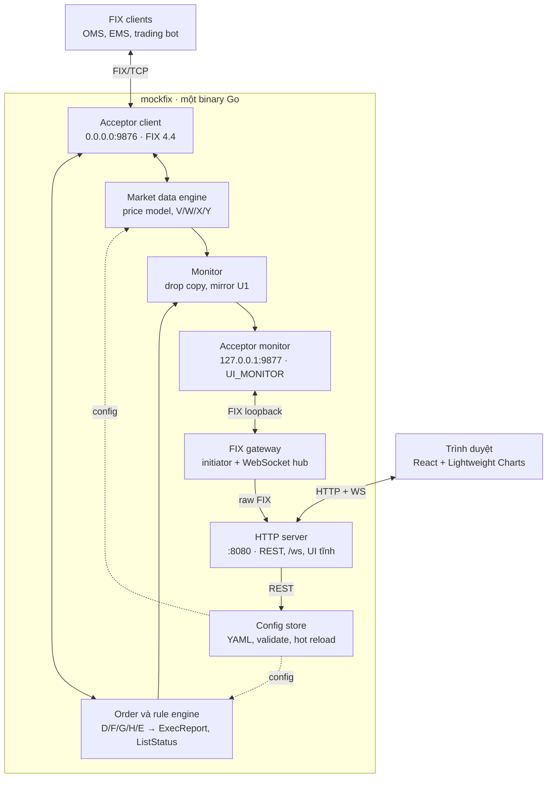

# Mock FIX Server — Design Document

Oct 2026 · @quynv

## 1. Overview

Mockfix is a simulated FIX server written in Go that runs as a single binary. It streams prices for configured symbols, accepts orders and answers with ExecutionReports according to predefined patterns, and is configured through a YAML file or a Web UI.

### 1.1 Background

OMS/EMS systems, trading bots and FIX clients in general need a FIX counterparty for development and testing. Connections to a real exchange or broker (UAT) usually have limited hours, give no control over prices, and cannot reproduce edge cases such as rejects, partial fills, timeouts or session drops. Mockfix fills that gap: a fully controllable FIX counterparty that runs locally or in CI.

### 1.2 Goals

- Stream market data over FIX (V/W/X/Y) per symbol, with configurable min/max price, tick speed, volatility, spread and price model.
- Accept NewOrderSingle, Cancel, Replace and Status, and respond according to rules: ack, fill, partial fill, reject, delay, no response, with slippage.
- Configure through YAML or the Web UI, with hot reload, versioning and rollback.
- All realtime data for the UI (prices, orders, logs) goes over FIX, so the UI sees exactly what real clients receive.
- Reproducible results when needed (fixed seed, replay from file).

### 1.3 Out of scope

- A real matching engine between clients or a shared order book.
- Long-term storage beyond the WAL retention (section 15); the MVP keeps state in memory.
- Exchange-grade performance; the target is enough for testing and moderate load tests.
- Authentication for the Web UI and Admin API: mockfix is an internal test tool.

### 1.4 Glossary

| Term | Meaning |
| --- | --- |
| Acceptor | The FIX side that waits for connections (server) |
| Initiator | The FIX side that initiates the connection (client) |
| Session | A SenderCompID/TargetCompID pair with its own sequence numbers |
| Price model | The algorithm that produces the next tick from the current price |
| Rule | Order match conditions plus a chain of response actions |
| Drop copy | A copy of ExecutionReports sent to an observer session |
| U1 | A user-defined FIX message used to mirror raw message logs |
| Gateway | The component that forwards FIX messages from the monitor session to the browser |

## 2. Requirements

The MVP must meet all functional requirements F1–F8 using only the YAML file; the Web UI (F9) comes in a later phase.

### 2.1 Functional requirements

| ID | Requirement | Priority |
| --- | --- | --- |
| F1 | Accept multiple FIX sessions (FIX 4.4) with configurable CompIDs | MVP |
| F2 | Register symbols with initial price, min, max, tick size, spread, depth | MVP |
| F3 | Generate prices with the random\_walk, gbm, sine and replay models; adjustable tick speed and volatility | MVP |
| F4 | Handle MarketDataRequest: snapshot, incremental, reject unknown symbols, unsubscribe | MVP |
| F5 | Handle D, F, G, H; return 8 and 9 with correct CumQty, LeavesQty, AvgPx, OrdStatus. The MVP accepts only OrdType=1 (Market) | MVP |
| F6 | Rule engine: match on symbol, side, ordType, qty, price, account, ClOrdID regex, CompID, any tag | MVP |
| F7 | Actions: ack, fill, partial\_fill, reject, cancel, expire, ignore, business\_reject, each step with a delay | MVP |
| F8 | Slippage: fixed, percent, random; always against the client | MVP |
| F9 | Web UI to edit symbols, rules, sessions, and view charts, logs, YAML | Phase 5 |
| F10 | Config hot reload with versioning and rollback | MVP |
| F11 | Runtime commands: pause/resume symbol, force price, spike | Phase 4 |
| F12 | Session fault simulation: reject logon, disconnect, sequence gap | Phase 6 |
| F13 | Drop copy and log mirroring over FIX to the monitor session | Phase 4 |
| F14 | Batch prices for multiple symbols into one X message, configurable per session (section 6.6) | MVP |
| F15 | Accept multiple orders in one message (NewOrderList E), cancel by list (K), mass cancel (q), aggregated reporting via ListStatus N (section 7.6) | Phase 3 |
| F16 | Write every event to a WAL with time-based retention; recover sequences and orders after restart; replay market data, order flow and sessions over a time range (section 15) | Phase 7 |

### 2.2 Non-functional requirements

| Area | Target |
| --- | --- |
| Throughput | ≥ 10 sessions, ≥ 200 symbols, ≥ 5,000 ticks/second in total on a 4-core machine |
| Order processing latency | p99 < 5 ms when the rule has no delay |
| Reproducibility | Same seed and same config produce the same price sequence |
| Hot reload | Applied in < 1 second without dropping open sessions |
| Deployment | One static binary + one YAML file; Docker image available |
| Fault isolation | A slow log or UI never slows down the trading path |

These targets are confirmed: mockfix is used for testing, so around 10 sessions is enough, and the other targets stay as they are.

## 3. Architecture

Mockfix is a single Go binary containing two FIX acceptors, the processing engines, a FIX gateway and an HTTP server; the UI receives realtime data through its own FIX session, looping back over loopback.



The dashed line is the configuration flow: the config store feeds configuration to every engine (the diagram draws a single arrow for brevity), and the HTTP server writes changes to the config store through REST.

### 3.1 Architectural decisions

| Decision | Reason | Trade-off |
| --- | --- | --- |
| One binary, no separate services | Simple deployment: one executable plus one YAML file | The gateway cannot be reused to observe other FIX servers |
| Realtime data for the UI goes over FIX | The UI sees exactly what real clients receive, through the same code path; the chart doubles as a feed verification tool | Requires a gateway and a browser-side FIX parser |
| The gateway is a real initiator over loopback instead of direct function calls | Preserves correct sequencing, data dictionary and session behavior | One extra internal TCP connection, negligible |
| Separate monitor acceptor bound to 127.0.0.1 only | External clients cannot log on as UI\_MONITOR and read all logs | Two acceptors to manage |
| WebSocket is only a pipe | Browsers cannot open raw TCP sockets | — |
| REST only for configuration and control commands | FIX has no suitable messages for configuration CRUD | Two protocols between UI and server |
| In-memory state | Simple, sufficient for testing | A restart loses orders and sequences until the WAL arrives in phase 7 (section 15) |

### 3.2 Main flows

1. A client logs on to the client acceptor and sends V; the market data engine registers it and starts pushing W/X at the symbol's tick speed.
2. The client sends D; the order engine picks a rule, schedules the action chain, sends 8 to the client and a drop copy to the monitor.
3. The monitor pushes drop copies and U1 through the monitor acceptor; the gateway receives them over loopback and forwards raw FIX to the browser via /ws.
4. A user edits configuration in the UI; REST sends it to the config store, which validates and swaps it, and the engines apply it immediately.

## 4. Technology stack and source layout

The backend is written in Go with quickfixgo; the frontend is React + TradingView Lightweight Charts, built into static files and embedded into the binary with go:embed.

### 4.1 Libraries

| Concern | Choice | Notes |
| --- | --- | --- |
| FIX engine | github.com/quickfixgo/quickfix | Generate the FIX44 package from the data dictionary with the quickfixgo generator, including U1 |
| YAML | gopkg.in/yaml.v3 | Keeps line positions for error reporting |
| Validation | github.com/santhosh-tekuri/jsonschema | One schema shared by backend and UI |
| Hot reload | github.com/fsnotify/fsnotify | Debounce of about 200 ms |
| HTTP | net/http (method-based routing in Go 1.22+) | No framework needed |
| WebSocket | github.com/coder/websocket | Used only as a pipe for raw FIX |
| Logging | log/slog | JSON logs |
| Metrics | prometheus/client\_golang | /metrics endpoint |
| Goroutine coordination | golang.org/x/sync/errgroup | Ordered startup and shutdown |
| UI | React, Vite, TypeScript, Monaco Editor, lightweight-charts | Lightweight Charts is Apache 2.0; keep the TradingView attribution |

### 4.2 Directory layout

```
mockfix/
├── cmd/mockfix/main.go        # wiring, startup, shutdown
├── internal/
│   ├── config/                # model, load, validate, watch, store (atomic)
│   ├── fixserver/             # quickfix.Application, MsgType router, settings from YAML
│   ├── marketdata/            # models, generator, subscription, publisher
│   ├── order/                 # state, rule engine, actions, slippage, executor
│   ├── monitor/               # drop copy, mirror U1
│   ├── gateway/               # initiator app, WS hub, ring buffer
│   ├── admin/                 # REST API, serves the static UI
│   └── clock/                 # Clock interface: Real and Fake
├── fix44/                     # generated from spec (do not edit by hand)
├── spec/FIX44.xml             # data dictionary with U1 and tags 5001–5003
├── schema/config.schema.json
├── configs/mock.yaml
├── web/                       # React app → web/dist is embedded
├── Makefile                   # make gen | web | build | test
└── Dockerfile
```

## 5. FIX session layer

The server runs two quickfixgo acceptors in the same process: one for external clients, and one bound to loopback only for the UI's monitor session.

### 5.1 Acceptors

| Acceptor | Address | Sessions | Purpose |
| --- | --- | --- | --- |
| Client | 0.0.0.0:9876 | MOCKSRV ↔ CLIENT1, CLIENT2, … | Real clients connect here |
| Monitor | 127.0.0.1:9877 | MOCKSRV ↔ UI\_MONITOR | The UI gateway connects here |

quickfixgo settings are generated in code from the YAML (quickfix.NewSettings and AddSession); there is no separate .cfg file. The store is MemoryStoreFactory; every start is a new trading day and sequences start at 1. Persisting sequences across restarts is done in phase 7 with the WAL (section 15). If the quickfixgo version in use does not support SocketAcceptHost, check TargetCompID in FromAdmin at Logon and block UI\_MONITOR from outside addresses with a firewall.

The client acceptor can require TLS with `server.fix.tls` (cert\_file, key\_file, client\_auth: none | request | require, client\_ca\_file), because real LP connections such as oneZero's are TLS with a client certificate and clients keep the same settings against the mock. mockfix builds the tls.Config itself and passes it to the acceptor rather than using quickfixgo's Socket\* settings, whose meaning of SocketUseSSL on an acceptor is to skip client certificates. The monitor acceptor stays plain TCP on loopback. `cmd/gencerts` writes a test CA, server and client certificates. A TLS change needs a restart.

### 5.2 Router

fixserver.App implements quickfix.Application and uses quickfix.MessageRouter to dispatch messages by MsgType:

| MsgType | Message | Routed to |
| --- | --- | --- |
| V | MarketDataRequest (one or more symbols) | marketdata.Publisher |
| D | NewOrderSingle | order.Engine |
| E | NewOrderList | order.ListHandler → order.Engine |
| F | OrderCancelRequest | order.Engine |
| G | OrderCancelReplaceRequest | order.Engine |
| H | OrderStatusRequest | order.Engine |
| K | ListCancelRequest | order.ListHandler |
| M | ListStatusRequest | order.ListHandler |
| q | OrderMassCancelRequest | order.Engine |
| other | — | BusinessMessageReject (j), reason 3: unsupported message type |

All four callbacks ToApp, FromApp, ToAdmin and FromAdmin call monitor.Mirror to log, except for messages of the UI\_MONITOR session (to avoid an infinite loop).

### 5.3 Data dictionary and the U1 message

spec/FIX44.xml is the standard FIX44 dictionary plus the following:

| Tag | Name | Type | Meaning |
| --- | --- | --- | --- |
| 5001 | MirrorSessionID | STRING | Source session, e.g. FIX.4.4:MOCKSRV->CLIENT1 |
| 5002 | MirrorDirection | CHAR | I = inbound, O = outbound |
| 5003 | MirrorRawMsg | DATA | Original message, SOH replaced by \| |
| 5004 | MirrorTime | UTCTIMESTAMP | Capture time, microsecond precision |

The U1 message (MirrorLog) contains 5001, 5002, 5003 and 5004 and is only sent server → UI\_MONITOR. FIX reserves MsgTypes starting with U for user-defined messages, so there is no conflict with the standard.

The U2 message (MonitorControl) contains tags 5005 ControlKey (STRING) and 5006 ControlValue (STRING), flows only UI\_MONITOR → server, and carries control commands for the monitor session such as turning U1 delivery on or off (section 8.3).

Only FIX 4.4 is supported today. To add other versions later (4.2, 5.0 SP2 over FIXT 1.1), the data dictionary and generated package are selected per session from the start, and the router works with internal types (Order, Quote) instead of being tied to the fix44 package. Phase 6 added FIX 4.2 and FIX 5.0 SP2 per session (section 14.2).

### 5.4 Session fault simulation (phase 6)

Configured per session: reject\_logon (reply with Logout and a text), drop\_after (drop TCP after N messages or N seconds), seq\_gap (skip MsgSeqNum to force the client to send ResendRequest), heartbeat\_miss (stop sending heartbeats).

## 6. Market data engine

Each symbol has a generator running at its own tick speed; the publisher fans quotes out over FIX to every session subscribed to that symbol.

### 6.1 Price models

A price model is the algorithm that produces the next tick from the current price. After the model returns a new price, the generator always does the same three things: reflects the price into \[min, max\], rounds it to tick\_size, then computes bid/ask = mid ∓ spread/2.

| Model | Formula | Use when |
| --- | --- | --- |
| random\_walk | p' = p + U(−v, +v) | Basic functional testing |
| gbm | p' = p × exp((μ − σ²/2)·dt + σ·√dt·Z) | Demos, realistic-looking data |
| sine | p = center + amplitude × sin(2π·t / period) + noise | Testing limit orders and strategy logic |
| replay | Read sequentially from CSV (time, bid, ask or mid) | Regression tests, reproducing events |

Here U is a uniform distribution, Z is a standard normal, v and σ come from volatility, and μ from drift (default 0). Each generator has its own rand.Rand seeded from seed, so the same seed gives the same price sequence. Boundary reflection: if p' > max then p' = 2·max − p'; likewise for min.

```go
type PriceModel interface {
    Next(prev float64, dt time.Duration) float64
}

type Quote struct {
    Symbol string
    Bid, Ask, Mid float64
    Levels []Level   // depth, Level{Px, Size}
    Seq    uint64
    Time   time.Time
}
```

### 6.2 Speed and scheduling

Speed is configured with ticks\_per\_second or interval\_ms, plus random jitter\_ms. There is no time.Ticker per symbol: a single scheduler uses a min-heap keyed by next tick time, and one goroutine wakes the generators that are due. This keeps the goroutine count stable with hundreds of symbols. All time goes through clock.Clock so tests can use a fast-forwarding Fake clock.

### 6.3 Subscription

| Situation | Server behavior |
| --- | --- |
| V with SubscriptionRequestType=0 (snapshot) | Send one W, do not register |
| V with SubscriptionRequestType=1 | Send W immediately, then X on every tick (or W continuously if update\_mode: snapshot) |
| V with SubscriptionRequestType=2 | Cancel by MDReqID, no response |
| Unregistered symbol | Y with MDReqRejReason=0 (unknown symbol) |
| Duplicate MDReqID in the same session | Y with MDReqRejReason=1 (duplicate MDReqID) |
| Session logout | Automatically cancel all subscriptions of that session |

MarketDepth=1 sends top of book only; any other value sends up to the configured depth\_levels. MDEntryType supports 0 (bid) and 1 (ask).

Two options reproduce LP behavior that clients depend on:

- `market_data.send_both_sides` (global, overridable per session) sends bid and offer entries whatever MDEntryTypes the request lists. oneZero does this, and the postprime price-gateway requests only 0 (bid) but drops any snapshot without both sides.
- `quote_condition` per symbol is sent as QuoteCondition (276) on every bid and offer entry, e.g. A (open, tradable) or B (closed). Without it, tag 276 is not sent.

### 6.4 Publisher

The publisher keeps a map of symbol → list of (sessionID, MDReqID). Each session has its own writer goroutine; a newer tick for the same subscription and symbol replaces a waiting one (conflation), so one slow client cannot slow down the others.

quickfix.SendToTarget never blocks: it appends to an unbounded queue, and while the connection is busy the session goroutine spins. The original design assumed it blocked; the load test (section 13) showed stale ticks piling up, order reports delayed by seconds and about ten cores busy. All application messages therefore go through per-session flow control: at most one message per session waits for the network (the connection wrapper reports each completed write), order messages go before market data, and nothing is queued for a session that is not logged on. Market data and U1 messages are not kept in the message store for resend; a ResendRequest gets a gap fill for them.

### 6.5 Runtime commands

The following commands take effect immediately and are not written to YAML: pause/resume symbol, set\_price (force the mid to a level), spike (jump by a given percentage in a given direction, then continue with the model), and quote\_cancel.

quote\_cancel simulates the LP withdrawing quotes: mockfix drops the subscriptions to the given symbols (all symbols when none are given) and sends each affected client session a QuoteCancel (Z) with QuoteCancelType 1 (listed securities, with NoQuoteEntries) or 4 (all quotes). Clients have to subscribe again to receive prices, which tests their resubscribe path. The monitor session is never included.

### 6.6 Batching multiple symbols into one message

When batching is enabled, the publisher collects ticks of multiple symbols within a time window and sends them together in one MarketDataIncrementalRefresh (X). This is valid in FIX 4.4 because each entry of the NoMDEntries group (268) carries its own Instrument (Symbol 55), so one X message can carry many symbols.

```yaml
market_data:
  batching:
    enabled: true
    scope: per_request          # per_request | per_session
    flush_interval_ms: 100      # tick collection window
    max_symbols_per_msg: 20
    max_entries_per_msg: 200    # split into multiple messages when exceeded
    conflate: true              # within a window, keep only the latest tick per symbol
    initial_snapshot: per_symbol_w   # per_symbol_w | batched_x

server:
  fix:
    sessions:
      - sender_comp_id: MOCKSRV
        target_comp_id: CLIENT1
        market_data: { batching: { enabled: false } }   # override for this session only
```

| Parameter | Meaning |
| --- | --- |
| scope: per\_request | Batch only symbols sharing one MDReqID, i.e. subscribed together in one V with NoRelatedSym (146) > 1. Standard-compliant: each X carries one MDReqID (262). Default. |
| scope: per\_session | Batch all symbols of the session regardless of MDReqID; the X message carries no 262. Use only if the client accepts this form. |
| flush\_interval\_ms | A message is sent when the window ends or when max\_symbols\_per\_msg / max\_entries\_per\_msg is reached, whichever comes first. |
| conflate | true: a symbol ticking 20 times per second in a 100 ms window keeps only its last tick. false: both ticks are kept as two consecutive entry groups for the same symbol, in order. |
| initial\_snapshot | per\_symbol\_w: one W per symbol as in the standard (W holds a single instrument). batched\_x: send the initial state as X with MDUpdateAction=0 (New) for many symbols at once. |

To let clients subscribe to multiple symbols in one request, V is handled with NoRelatedSym > 1. If the list contains an unregistered symbol, the server returns Y for the whole request (MDReqRejReason=0) and registers none of them, matching the reject-by-MDReqID semantics.

Batching adds up to exactly flush\_interval\_ms of latency, in exchange for far fewer messages when there are many symbols. The mockfix\_md\_batch\_size metric (histogram, session label) tracks the average number of symbols per message. In the UI, the gateway subscribes per\_request, so the chart is unaffected by other clients' configuration.

## 7. Order handler and rule engine

Each new order is checked against the rule list in ascending priority; the first matching rule decides the chain of ExecutionReports sent back, and if no rule matches, default\_action is used.

### 7.1 Supported messages

| Inbound | Outbound | Notes |
| --- | --- | --- |
| D NewOrderSingle | 8 (New, PartialFill, Fill, Rejected…) | Required fields are checked before rules run |
| F OrderCancelRequest | 8 (Canceled) or 9 | 9 with CxlRejReason=1 if the order is closed or unknown |
| G OrderCancelReplaceRequest | 8 (Replaced) or 9 | Change qty/price, rerun the remaining actions with the new values |
| H OrderStatusRequest | 8 (ExecType=I, Order Status) | Returns the current state |

Cancel and Replace also go through the rule engine with message\_type: F or G, so cancels can be rejected or replaces delayed by configuration.

The MVP supports Market orders only. Orders with an OrdType other than 1 are rejected immediately with OrdRejReason=11 (unsupported order characteristic) before rules run; for G, only OrderQty may change. Limit, Stop, IOC and FOK are left for a later phase. Phase 6 added Limit, Stop and Stop limit orders with Day, GTC, IOC and FOK (section 14.2).

### 7.2 Matching

Conditions in match are ANDed together. Supported operators:

| Operator | YAML example | Applies to |
| --- | --- | --- |
| equals | symbol: AAPL | Strings, enums |
| in list | side: \[BUY, SELL\_SHORT\] | Strings, enums |
| comparison | qty: { gt: 1000, lte: 5000 } | qty, price |
| regex | cl\_ord\_id: { regex: "^TIMEOUT-" } | Strings |
| any tag | tags: { "9001": "VIP" } | Any tag on the message |
| probability | probability: 0.2 | Random 20% match, using the engine seed |

Rules are compiled once when config loads (regexes precompiled, enums pre-mapped), so matching is just a walk over a sorted slice.

Rules depend only on message content and keep no state across orders: there are no conditions such as "the Nth order of the session" or "after X lots have filled". The outcome of an order therefore never depends on earlier orders, and the rule tester (POST /api/rules/test) always gives the same result as live execution.

### 7.3 Actions

| Action | Result | Parameters |
| --- | --- | --- |
| ack | 8 ExecType=New | delay\_ms |
| fill | 8 Fill for the remaining quantity | delay\_ms, price\_mode |
| partial\_fill | 8 PartialFill | ratio or qty, count (split into several fills), delay\_ms |
| reject | 8 Rejected | reason (OrdRejReason), text |
| cancel | 8 Canceled (unsolicited) | delay\_ms, text |
| expire | 8 Expired | delay\_ms |
| ignore | Nothing is sent | — |
| business\_reject | j BusinessMessageReject | reason, text |

Action chains run asynchronously: the executor puts each step on the scheduler at its cumulative delay. If the client cancels or replaces midway, the order's remaining steps are cancelled or recomputed.

```go
type Rule struct {
    Name     string
    Priority int
    Match    Matcher
    Actions  []Action
}

type Action interface {
    Delay() time.Duration
    Apply(ctx context.Context, o *Order, q marketdata.Quote, out ExecSender) error
}
```

### 7.4 Fill price and slippage

| price\_mode | Fill price | Available from |
| --- | --- | --- |
| market (default) | Ask for BUY, bid for SELL, plus slippage | MVP |
| fixed | Fixed price from the rule, no slippage | MVP |
| limit\_immediate | The order's limit price, no slippage | Later phase, with Limit orders |
| market\_driven | Wait until the quote reaches the limit, then fill; fill price never worse than the limit | Later phase, with Limit orders |

Slippage always goes against the client (higher for BUY, lower for SELL):

| Type | Calculation |
| --- | --- |
| fixed | n × tick\_size |
| percent | price × value / 100 |
| random | U(min\_ticks, max\_ticks) × tick\_size |

When Limit orders are supported in a later phase, the price after slippage will be clamped at the limit so the order price is never violated.

### 7.5 Order state

State lives in memory, keyed by OrderID with a secondary index on (sessionID, ClOrdID). Each order holds OrderQty, CumQty, LeavesQty, AvgPx, OrdStatus and its list of fills. Invariants checked in tests: CumQty + LeavesQty = OrderQty (unless closed), and AvgPx is the weighted average of the fills. Closed orders are retained per order\_retention (default: the latest 10,000 orders) to answer H and for UI lookups. A duplicate ClOrdID within a session is rejected with OrdRejReason=6.

### 7.6 Multiple orders in one message

Clients send several orders at once with NewOrderList (E); the server splits the list into individual orders, runs each through the rule engine like D, and reports according to configuration: a separate ExecutionReport per order, an aggregated ListStatus (N) for the whole list, or both.

| Inbound | Outbound | Notes |
| --- | --- | --- |
| E NewOrderList | N (ListStatusType=1 Ack), then 8 per order and/or an aggregated N | ListID (66), TotNoOrders (68), NoOrders group (73) with ClOrdID, ListSeqNo (67), Symbol, Side, OrderQty, OrdType, Price |
| K ListCancelRequest | N plus 8 Canceled for each open order | Closed orders keep their state |
| M ListStatusRequest | N with ListStatusType=2 (Response) | Returns the state of every order in the list |
| q OrderMassCancelRequest | r OrderMassCancelReport plus 8 Canceled | MassCancelRequestType: by symbol (1) or all (7) |

FIX 4.4 has no message that aggregates multiple ExecutionReports, so the standard way to report in aggregate is ListStatus (N): the NoRpts group (82) carries ClOrdID, CumQty, LeavesQty, CxlQty, AvgPx and OrdStatus for each order.

```yaml
order_lists:
  enabled: true
  max_orders_per_list: 100
  ack: list_status              # list_status | none
  report: per_order_er          # per_order_er | list_status | both
  list_status_interval_ms: 500  # when report includes list_status: send an aggregated N periodically, only on change
  final_list_status: true       # send N with ListStatusType=5 (All done) once every order is closed

list_rules:
  - name: reject-big-list
    priority: 1
    match: { tot_no_orders: { gt: 50 } }
    action: { type: reject_list, text: "List too large" }
  - name: slow-list
    priority: 10
    match: { list_id: { regex: "^SLOW-" } }
    action: { type: delay_ack, delay_ms: 1000 }
```

Processing order for a list:

1. Structural checks: TotNoOrders matches the entry count, ClOrdIDs are unique, the ListID is unused in the session. On failure, return N with ListOrderStatus (431)=7 (Reject) and ListStatusText (444), and create no orders.
2. Run list\_rules (list-level rules). reject\_list rejects the whole list as in step 1; delay\_ack postpones the N Ack.
3. Send the N Ack if ack: list\_status.
4. Each order goes through order\_rules like D. Rules can additionally match in\_list: true or list\_id to tell single orders from list orders; for example, reject only the third order with the condition list\_seq\_no: 3.
5. Report according to report: per\_order\_er sends 8 as usual, each carrying the ListID; list\_status collects changes and sends N every list\_status\_interval\_ms; both sends both.

List state (ListID → OrderIDs, overall status) sits next to the order state of section 7.5. Drop copy also forwards N to UI\_MONITOR. In the UI, the Orders screen groups orders by ListID, and the Order rules screen gains a List rules section. New validation constraints: max\_orders\_per\_list > 0, unique list\_rules names, and report: list\_status requires list\_status\_interval\_ms > 0.

## 8. Monitor and FIX gateway

The UI receives all realtime data through the UI\_MONITOR FIX session; the in-process gateway is a real initiator connecting over loopback, and WebSocket is only the pipe carrying raw FIX to the browser.

### 8.1 Monitor (server side)

| Data | Message to UI\_MONITOR | Source |
| --- | --- | --- |
| Prices | W/X, like any client | The gateway sends V for the symbols the UI is viewing |
| Orders of every client | 8 drop copy, with tag 5001 naming the source session | order.Engine after each ExecutionReport |
| Raw message log | U1 MirrorLog | ToApp/FromApp/ToAdmin/FromAdmin callbacks |

The mirror writes into a buffered channel (mirror\_buffer, default 10,000). When full, it drops log messages and increments the mockfix\_mirror\_dropped\_total counter; it never blocks. Mirroring can be filtered by MsgType (for example, skipping heartbeat 0) to reduce load.

### 8.2 Gateway

- quickfixgo initiator, session UI\_MONITOR → MOCKSRV at 127.0.0.1:9877, with automatic reconnect.
- The hub keeps the list of WebSocket connections; each connection has its own channel buffer (default 1,000). Slow readers are closed with code 1008 instead of blocking the hub.
- Subscription sharing: several tabs viewing the same symbol produce a single V; the hub reference-counts and sends a cancelling V when the last tab leaves.
- A ring buffer keeps the latest history\_ticks X messages per symbol; when the UI subscribes, the hub replays the ring buffer before joining the live stream, so the chart has data immediately.

### 8.3 WebSocket protocol (/ws)

Each text frame is one complete FIX message, with SOH replaced by |. The browser sends exactly three kinds of messages, also in FIX form:

| Browser sends | Meaning |
| --- | --- |
| 35=V\|262=…\|263=1\|55=EURUSD | Subscribe to prices |
| 35=V\|262=…\|263=2 | Unsubscribe |
| 35=U2\|5005=log\|5006=on | Turn U1 delivery on/off (off by default to save bandwidth) |

The gateway checks MsgType before forwarding; the UI cannot send D, F or G through this path. The header (BeginString, SeqNum, CompIDs) is filled in by the gateway; the browser sends only the body.

## 9. Configuration

YAML is the single source of truth: the UI edits and writes back to that same file, and every change takes effect only after it validates successfully and is swapped in as a whole.

### 9.1 Sample configuration file

```yaml
version: 12
server:
  fix:
    listen: 0.0.0.0:9876
    version: FIX.4.4
    data_dictionary: spec/FIX44.xml
    sessions:
      - { sender_comp_id: MOCKSRV, target_comp_id: CLIENT1 }
      - { sender_comp_id: MOCKSRV, target_comp_id: CLIENT2, faults: { seq_gap: { every: 500 } } }
  monitor:
    enabled: true
    listen: 127.0.0.1:9877
    sender_comp_id: MOCKSRV
    target_comp_id: UI_MONITOR
    drop_copy: true
    mirror_log: true
    mirror_buffer: 10000
    mirror_exclude: ["0"]
  http:
    listen: 0.0.0.0:8080
    history_ticks: 5000

symbols:
  - symbol: EURUSD
    initial_price: 1.0850
    min: 1.0700
    max: 1.1000
    tick_size: 0.00001
    model: gbm
    volatility: 0.0002
    speed: { ticks_per_second: 5, jitter_ms: 50 }
    spread: 0.00010
    depth_levels: 5
    update_mode: incremental
    slippage: { type: random, min_ticks: 0, max_ticks: 3 }
    seed: 42
  - symbol: AAPL
    initial_price: 230.0
    min: 200
    max: 260
    tick_size: 0.01
    model: replay
    replay: { file: data/aapl.csv, loop: true }
    speed: { interval_ms: 500 }
    spread: 0.02
    slippage: { type: percent, value: 0.05 }

order_rules:
  - name: reject-large-qty
    priority: 1
    match: { qty: { gt: 1000000 } }
    actions:
      - { type: reject, reason: 3, text: "Order exceeds limit" }
  - name: timeout-test
    priority: 5
    match: { cl_ord_id: { regex: "^TIMEOUT-" } }
    actions:
      - { type: ignore }
  - name: partial-then-fill-aapl
    priority: 10
    match: { symbol: AAPL, side: BUY, ord_type: MARKET }
    actions:
      - { type: ack, delay_ms: 50 }
      - { type: partial_fill, ratio: 0.4, delay_ms: 300 }
      - { type: fill, delay_ms: 800 }

default_action:
  - { type: ack, delay_ms: 20 }
  - { type: fill, delay_ms: 100 }
```

### 9.2 Validation

schema/config.schema.json is embedded in the binary and served to the UI at /api/schema. Beyond the schema, the backend checks cross-field constraints:

- min < max and min ≤ initial\_price ≤ max.
- tick\_size > 0; spread is a multiple of tick\_size.
- Symbol names, rule names and priorities are unique.
- Regexes compile; replay files exist and are readable.
- CompIDs do not collide between client sessions and the monitor session.

Errors come back with a path (symbols\[0\].max) and the YAML line number, so the UI can highlight the right field and the YAML editor can jump to the right line.

### 9.3 Hot reload and versioning

1. A change arrives from fsnotify (hand-edited file, 200 ms debounce) or from PUT /api/config.
2. Parse and validate. On error, keep the old config and report the error via the API and logs.
3. Diff against the running config, bump the version, save the old copy to configs/history/ (keeping the latest 20).
4. Swap atomic.Pointer\[Config\]; each engine receives a change event and applies its part.
5. Write the YAML file (if the change came from the UI), ignoring the fsnotify event this generates.

Hot-apply scope:

| Change | Applied |
| --- | --- |
| Symbol parameters, adding/removing symbols | Immediately; the current price is kept if still within \[min, max\] |
| Rules, default\_action | Immediately for new orders; in-flight orders keep their old action chain |
| Adding/removing client sessions | Immediately; removed sessions are logged out |
| listen, port, data\_dictionary | Requires a restart; the API reports restart\_required |

PUT /api/config supports If-Match on the version: if two people edit at once, the later save gets 409 and must reload.

## 10. Admin REST API

REST serves only configuration and control commands; all realtime data goes over FIX (section 8). All endpoints live under /api, return JSON, and report errors as { code, message, details\[\] }.

| Method | Path | Description |
| --- | --- | --- |
| GET | /api/config | Current config (JSON), ETag header = version |
| GET | /api/config.yaml | Config as YAML |
| PUT | /api/config | Replace the whole config (JSON or YAML), requires If-Match |
| POST | /api/config/validate | Validate only, do not apply |
| GET | /api/config/history | List of saved versions |
| POST | /api/config/rollback/{version} | Roll back to a version |
| GET | /api/schema | JSON Schema of the config |
| GET, POST | /api/symbols | List, add symbols |
| GET, PUT, DELETE | /api/symbols/{symbol} | View, edit, delete a symbol |
| POST | /api/symbols/{symbol}/pause | Runtime command: pause |
| POST | /api/symbols/{symbol}/resume | Runtime command: resume |
| POST | /api/symbols/{symbol}/price | Runtime command: force price, body { mid } |
| POST | /api/symbols/{symbol}/spike | Runtime command: body { percent, direction } |
| POST | /api/symbols/{symbol}/quote-cancel | Runtime command: QuoteCancel for one symbol |
| POST | /api/quote-cancel | Runtime command: body { symbols (empty: all quotes), session (optional) } |
| GET, POST | /api/rules | List, add rules |
| PUT, DELETE | /api/rules/{name} | Edit, delete a rule |
| PUT | /api/rules/order | Bulk priority change (drag and drop) |
| POST | /api/rules/test | Body is a sample order; returns the matching rule and its action chain |
| GET | /api/sessions | Sessions, logon state, sequences in/out |
| POST | /api/sessions/{id}/logout | Disconnect a session |
| POST | /api/sessions/{id}/fault | Trigger an immediate fault, body { type: drop, seq\_gap or heartbeat\_miss } |
| GET | /api/orders?session=&status=&limit= | Look up in-memory orders |
| GET | /healthz, /metrics | Health check, Prometheus |

The partial-edit endpoints (symbols, rules) are only shortcuts: internally they build a new config from the current one and go through the same validate-and-swap path as section 9.3, so they always create a new version.

## 11. Web UI

The UI is a single-page React application with a list on the left and an editor on the right; edits only mark the config as unsaved, and nothing reaches the server until Apply is pressed.

### 11.1 Shell

The top bar holds the app name, navigation (Dashboard, Symbols, Order rules, Sessions, FIX log, YAML), config status (version, applied or unsaved, validation errors) and the Apply button. A status bar shows the connection to the gateway; on disconnect the UI reconnects automatically and replays the ring buffer.

### 11.2 Screens

| Screen | Main content | Actions |
| --- | --- | --- |
| Dashboard | Logged-on sessions, subscription count, messages/second, recent orders from drop copy | Jump to a session or order |
| Symbols | Symbol list; editor for model, min/max, tick size, seed, speed, volatility, spread, slippage; live price chart | Add, edit, delete; pause, spike, set price; local preview |
| Order rules | List by priority; conditions as chips; action chain as a timeline with total latency; tester with a sample order | Drag to reorder priority, add conditions/actions, test rules |
| Sessions | CompIDs, state, sequences in/out, configured faults | Logout, trigger an immediate fault |
| Orders | Order table filtered by session, symbol, status; every ExecutionReport per order | View an order's message chain |
| FIX log | U1 stream filtered by session, direction, MsgType; tag-by-tag parse panel with field names | Pause the stream, search, copy raw |
| YAML | Monaco editor validating against the schema, diff with the running config, version history | Apply, roll back |

### 11.3 Chart

Uses TradingView Lightweight Charts (Apache 2.0, default attribution logo kept). The useFixStream(symbol) hook receives parsed W/X messages; ticks are aggregated into candles at a selectable interval (1s, 5s, 1m) and updated with series.update. The chart adds bid and ask lines, dashed lines for min/max, and markers at fills taken from the drop copy, making slippage against the feed price directly visible.

The Symbols screen also has a preview mode: it runs the same price model in the browser with the parameters being edited, so they can be tried before Apply. The models are reimplemented in TypeScript with the same formulas as section 6.1; the preview only shows the shape and is not expected to match the server number for number.

### 11.4 Browser-side FIX parser

A small custom parser: split on |, map tags to field names using a trimmed data dictionary (generated at build time from spec/FIX44.xml), and handle repeating groups for MDEntries (268) and NoPartyIDs if needed. No dependency on any JavaScript FIX library.

### 11.5 UX principles

- Editing and Apply are separate; unsaved config is clearly marked, and leaving the page asks for confirmation.
- Validation errors appear right next to the relevant field; Apply stays clickable and returns the list of errors.
- Runtime commands (pause, spike, set price) use different icons and colors from configuration edits, with a note that they are not saved to YAML.
- When someone else has just applied (the version changed), the UI shows a notice and offers to reload instead of overwriting.

## 12. Operations

Mockfix starts in the order acceptors, initiator, engines, HTTP and shuts down in reverse, so no session is cut off without a Logout.

### 12.1 Startup and shutdown

1. Load and validate the config; on error, exit with code 2 and print the errors with line numbers.
2. Start the client acceptor and the monitor acceptor.
3. Start the gateway initiator.
4. Run the market data engine, order engine and config watcher in an errgroup.
5. Open the HTTP server (REST, /ws, static UI).
6. On SIGINT/SIGTERM: close HTTP, stop the initiator, send Logout to every client session, stop the acceptors, wait for the errgroup for up to 10 seconds.

```go
ctx, stop := signal.NotifyContext(context.Background(), os.Interrupt, syscall.SIGTERM)
defer stop()
g, ctx := errgroup.WithContext(ctx)

must(clientAcc.Start()); must(monAcc.Start())
must(gwInit.Start())
g.Go(func() error { return md.Run(ctx) })
g.Go(func() error { return ord.Run(ctx) })
g.Go(func() error { return store.Watch(ctx) })
g.Go(func() error { return admin.Serve(ctx, store, hub, webFS) })

<-ctx.Done()
gwInit.Stop(); clientAcc.Stop(); monAcc.Stop()
_ = g.Wait()
```

### 12.2 Packaging and deployment

- make build: build the UI (vite build), then go build with CGO\_ENABLED=0, producing one static binary.
- Multi-stage Docker image on a distroless base; mount configs/ and data/ (replay files) as volumes.
- Command-line flags: --config, --log-level, --no-ui (skip HTTP and the gateway when running in CI).
- Expose ports 9876 (FIX) and 8080 (HTTP); 9877 is never published outside the container.

### 12.3 Logging and metrics

JSON logs via slog: session events (logon, logout, reject), config reloads (version, summarized diff, errors), order processing errors. quickfixgo's full FIX message logs go to a separate file per session and can be turned off.

| Metric | Type | Labels |
| --- | --- | --- |
| mockfix\_sessions\_logged\_on | gauge | — |
| mockfix\_fix\_messages\_total | counter | session, direction, msg\_type |
| mockfix\_ticks\_total | counter | symbol |
| mockfix\_md\_subscriptions | gauge | symbol |
| mockfix\_md\_conflated\_total | counter | session |
| mockfix\_orders\_total | counter | session, rule, result |
| mockfix\_order\_latency\_seconds | histogram | msg\_type |
| mockfix\_mirror\_dropped\_total | counter | — |
| mockfix\_config\_version | gauge | — |
| mockfix\_config\_reload\_errors\_total | counter | — |

### 12.4 Security

- No authentication for the Web UI, Admin API or /ws: mockfix is a test tool that runs only on developer machines, in CI or on the internal network.
- The monitor acceptor binds only to 127.0.0.1; the gateway is the only permitted client.
- The client acceptor can require TLS and client certificates (`server.fix.tls`, section 5.1); the Logon Password (554) is accepted without checking.
- /ws accepts only MsgTypes V and U2 from the browser (section 8.3), so the UI cannot place orders on behalf of clients.
- Mockfix uses no real data or accounts and must not be exposed to the public Internet.

## 13. Testing strategy

All time-dependent logic runs on clock.Fake, so tests of action chains spanning several seconds still finish in milliseconds and give stable results.

| Level | Scope | Tools |
| --- | --- | --- |
| Unit | Price models: always within \[min, max\], correct tick size, same seed gives the same sequence; rule matching; slippage; CumQty/LeavesQty/AvgPx invariants; config validation | go test, table-driven, clock.Fake |
| Property | Generate random orders and cancel/replace sequences; check that order state invariants never break | testing/quick or rapid |
| Integration | Real test initiator: logon → V → receive W/X → D → check the 8 chain per rule; F/G midway; unknown symbol → Y | quickfixgo initiator inside go test |
| Golden | With a fixed seed, compare the FIX message sequence (ignoring SendingTime) to golden files | testdata/\*.fix |
| Hot reload | Edit YAML while sessions and orders are live: no session drops, old orders keep their old actions | go test |
| UI | FIX parser, candle aggregation, form validation; one end-to-end Apply config flow | Vitest, Playwright |
| Load | 10 sessions × 200 symbols × 25 ticks/second; measure order p99 latency, CPU, memory, conflation | A dedicated initiator tool in cmd/loadgen |

CI runs unit, property, integration and golden tests on every pull request; load tests run nightly and results are kept for trend comparison.

## 14. Roadmap, risks and decisions

The MVP runs entirely on YAML after phase 3, about 3–4 weeks for one person; the version with the full Web UI needs roughly another 2.5–3 weeks.

&#91;embedded content: roadmap · 8 phases, MVP gate after phase 3\]

Estimates assume one Go engineer familiar with FIX; phase 5 can run in parallel with phase 4 if someone works on the frontend.

### 14.1 Risks

| Risk | Impact | Mitigation |
| --- | --- | --- |
| Clients use their own FIX dialect (custom tags, different required fields) | Clients cannot parse messages or get rejected | Per-session data dictionary; disable ValidateUserDefinedFields when needed |
| Fast ticks with many subscribers | High CPU, full send queues, rising latency | Shared scheduler, encode once, per-session conflation |
| Log mirroring overload | Affects the trading path | Non-blocking channel, counted drops, MsgType filtering |
| Hot reload while orders are in flight | Hard-to-predict behavior | Orders keep their old action chain; dedicated tests for this case |
| quickfixgo lacks a feature (bind by host, stores) | Extra code to write | Check in phase 0; fallback in section 5.1 |
| UI price preview differs from the server | Users get confused | State clearly that the preview only simulates the shape |

### 14.2 Decisions made

| Question | Decision | Impact on the design |
| --- | --- | --- |
| FIX versions | FIX 4.4 only for now; multiple versions later | Done in phase 6: per-session `version` FIX.4.2, FIX.4.4 or FIX.5.0SP2 (FIXT.1.1). Non-default versions are static acceptor sessions created at start (adding one needs a restart); FIX 4.2 ExecutionReports carry ExecTransType and ExecType 1/2 for fills; drop copies stay FIX 4.4 |
| Order types in the MVP | Market only | Phase 6 added Limit, Stop and Stop limit with Day, GTC, IOC and FOK: unmarketable fill steps wait for the market, fills are clamped at the limit, IOC/FOK cancel what cannot fill; Day orders do not expire |
| Do rules keep state | Message content only | Rules do not count orders or remember history (section 7.2) |
| Persist sequences across restarts | Phase 7, with the WAL | The MVP uses MemoryStoreFactory; phase 7 replaces it with a WAL-backed store with retention and replay (section 15) |
| Web UI authentication | Not needed, it is a test tool | No auth token; runs only on the internal network (section 12.4) |
| Throughput | About 10 sessions; other targets unchanged | Updated in section 2.2 and the load test in section 13 |
| Sending to slow clients | Per-session flow control instead of relying on quickfix.SendToTarget | One message in flight per session, orders first, market data conflated (section 6.4). Load test 10 × 200 × 25: 51,000 messages/s delivered, order handling p99 ≤ 0.1 ms |
| Generated FIX code | Not committed | `fix/` is generated from spec/FIX44.xml by `make gen` / `go generate ./fix` |
| Config edits from the UI | The draft is the YAML text, edited through a YAML document | Comments and layout survive; validation stays on the server (section 11) |
| Rule values | side: BUY, SELL; ord\_type: MARKET, LIMIT, STOP, STOP\_LIMIT; time\_in\_force: DAY, GTC, IOC, FOK | Names only, no raw FIX values or regex for these fields |
| TLS on the client acceptor | Supported (`server.fix.tls`) | Needed for clients configured for TLS LPs (section 5.1) |
| Both sides in market data | Option `send_both_sides` | Matches LPs that ignore MDEntryTypes (section 6.3) |
| QuoteCondition (276) | Per-symbol `quote_condition` | Clients that require 276=A to trade (section 6.3) |
| QuoteCancel (Z) | Runtime command | Tests clients' resubscribe handling (section 6.5) |
| Symbol names for a client | Kept in sync by the developer | mockfix does not read client product lists |

### 14.3 Compatibility with the postprime-sec gateways

mockfix is used as the LP (oneZero) for `order-gateway` and `price-gateway` of postprime-sec. What they rely on, and how mockfix covers it:

| Client behavior | mockfix |
| --- | --- |
| quickfixgo initiator, FIX 4.4, TLS with a client certificate and no server verification | `server.fix.tls` with client\_auth none or request |
| Separate sessions: PostPrimeTaker\_T ↔ TakaTradeUAT\_T (orders), PostPrimeTaker\_Q ↔ TakaTradeUAT\_Q (prices); ResetOnLogon/ResetOnLogout, Logon with ResetSeqNumFlag=Y and Password | Configured CompIDs; quickfixgo resets sequences; the password is not checked |
| order-gateway: D Market, HandlInst=1, TimeInForce=FOK, 2-decimal OrderQty; waits up to 5 s for a final ExecutionReport (OrdStatus 2, 8, 4 or C) and reads LastPx, OrdRejReason, Text | Accepted; rules decide fill, reject, cancel or no answer (to test the 5 s timeout) |
| price-gateway: one V per ticker, SubscriptionRequestType=1, MarketDepth=0, MDUpdateType=0, MDEntryType 0 only | W on every tick (full refresh) |
| price-gateway drops W without both a bid and an offer, and treats a price as tradable only with 276=A on every entry | `send_both_sides: true` on the price session and `quote_condition: A` on the symbols |
| price-gateway resubscribes after QuoteCancel type 4 (all quotes); type 1 is only logged | quote\_cancel runtime command |
| Product tickers (e.g. XAUUSD, XAGUSD, XPTUSD, XPDUSD, CrudeOil) | Symbols in the mock config, kept in sync by the developer |

An end-to-end test (`internal/app/postprime_test.go`) drives mockfix with clients configured like both gateways.

## 15. Persistence with a WAL (phase 7)

Every mockfix event is written sequentially to a segmented write-ahead log kept for a configurable period (retention). From the WAL, the server recovers sequences and orders after a restart, and can replay any time range still within retention.

### 15.1 Goals

- A restart does not lose sequence numbers; clients reconnect normally and ResendRequest is served from the WAL.
- Recover open orders and the current price of every symbol.
- Time-based retention (for example 24h, 7d) plus a size cap; old data is deleted automatically.
- Replay a time range: market data, order flow, or one session's messages (section 15.8).
- WAL writes must not noticeably slow the trading path: order p99 latency increases by no more than 1 ms with periodic fsync.

### 15.2 Recorded data

| Record type | Content | Default |
| --- | --- | --- |
| FIX\_IN, FIX\_OUT | SessionID, MsgSeqNum, raw message | On |
| SEQ | Next sender/target seq of the session (on reset, logon, SequenceReset) | Always on when recovery is on |
| TICK | Symbol, bid, ask, depth (depending on mode) | top\_of\_book |
| ORDER\_EVENT | Order and list state transitions: created, filled, cancelled, rejected, with pending actions | On |
| CONFIG | Version and the applied YAML | On |
| SESSION | Logon, logout, disconnects, simulated faults | On |
| RUNTIME | pause, set\_price, spike commands | On |

Tick recording modes: none (not recorded), top\_of\_book (bid/ask only, about 40–60 bytes per tick), full\_depth (all levels, much larger). At the target load of 5,000 ticks/second in top\_of\_book, the WAL grows by about 1 GB per hour before compression; this is a rough estimate to be measured in load tests.

### 15.3 Format

The WAL lives in one directory as segment files named by their first LSN (00000000000000000001.wal). Each record:

| Field | Size | Notes |
| --- | --- | --- |
| length | uint32 | Payload length |
| crc | uint32 | CRC32C over type, ts, lsn, payload |
| type | uint8 | Record type from section 15.2 |
| ts | int64 | Time, Unix nanoseconds (from clock.Clock) |
| lsn | uint64 | Globally increasing sequence number |
| payload | length bytes | Protobuf (google.golang.org/protobuf) so fields can be added without breaking the old format |

Each segment starts with a header (magic, format version, first LSN, first ts). When a segment is sealed, the server writes a footer with the last ts, last LSN and a sparse index (ts → offset, every 1,000 records), so replay can seek to any point in time without reading the segment from the start. A segment is sealed when it reaches segment\_max\_bytes or segment\_max\_duration; sealed segments are compressed with zstd (github.com/klauspost/compress/zstd).

### 15.4 Write path

- A single writer goroutine receives records over a channel, batches them and writes them at once (group commit).
- fsync policy: always (fsync every batch, safest), interval (default, fsync every fsync\_interval\_ms, losing at most that window on a machine crash), none (left to the OS).
- FIX, SEQ and ORDER\_EVENT records are written synchronously: the caller waits until the batch is written to the file (not necessarily fsynced) before continuing, so WAL order always matches real order.
- TICK records are written asynchronously; when the channel is full, the tick is dropped and mockfix\_wal\_ticks\_dropped\_total is incremented. Losing a few ticks in the WAL is acceptable; slowing the price stream is not.

To recover sequences, the WAL is plugged into quickfixgo through a custom MessageStoreFactory (WALStoreFactory). The store keeps sequences and recent messages in memory like MemoryStore, while writing SEQ and FIX\_OUT to the WAL; on startup it reloads from the snapshot plus the WAL. ResendRequest is served from memory, falling back to the WAL when needed.

### 15.5 Retention

A janitor goroutine runs every minute: it deletes sealed segments whose last ts is older than the retention, then, if total size still exceeds max\_total\_bytes, deletes further segments starting from the oldest. The segment being written is never deleted, and the segments needed by the latest snapshot are always kept. Retention can be changed by hot reload; a shorter retention takes effect on the janitor's next run.

### 15.6 Snapshots

Periodically (snapshot.interval, default 5 minutes) the server writes a snapshot file containing: the LSN at capture time, the sequences of every session, open orders and lists with their pending actions, the current price and generator state of every symbol (including the seeded random state), and the config version. Snapshots are written to a temporary file and then renamed, so they are never partial. Thanks to snapshots, recovery only has to read the WAL from the snapshot's LSN onwards.

### 15.7 Recovery at startup

1. Read the latest valid snapshot.
2. Read the WAL from the snapshot's LSN to the end. If the last record is corrupt (bad CRC, missing bytes after a crash), truncate the file at the last valid record and log a warning.
3. Rebuild session sequences, orders and lists, and symbol prices.
4. Handle open orders according to recovery.open\_orders: resume (reschedule pending actions for their remaining time), cancel (send 8 Canceled when the client logs on again), keep\_open (keep as is, no automatic fills).
5. Open the acceptors. Clients log on with their old sequences; if a client is behind, the server serves ResendRequest from the WAL.

The config used at startup is always the current YAML file, not the copy in the WAL; if its version differs from the snapshot, the server logs a warning and applies the current file.

### 15.8 Replay

Replay reads the WAL for a range \[from, to\] within retention, at a speed factor (speed: 1 is real time, 10 is ten times faster, max is as fast as possible). There are three kinds:

| Kind | Records read | Result | Use when |
| --- | --- | --- | --- |
| market\_data | TICK records of the selected symbols | Generators of those symbols pause; old ticks are replayed to clients over FIX like live ticks, preserving the time gaps between ticks (divided by speed) | Reproducing a specific price period; new client orders fill at the replayed prices |
| order\_flow | FIX\_IN (D, E, F, G, H, K, q) of the selected sessions | Fed back into the order engine with the current rules, on a virtual session, without sending anything out; new ExecutionReports are compared with the recorded FIX\_OUT and a diff report is produced | Checking the impact of rule changes (regression) |
| session | FIX\_OUT of a source session | App-level messages (W, X, 8, N…) are resent to a connected target session with new sequence numbers, preserving time gaps | Reproducing a client-side bug with the exact message sequence that triggered it |

General rules:

- Each replay is a job with an ID, a state (running, paused, done, failed) and progress; it can be paused, resumed and stopped.
- Only one market\_data replay per symbol at a time. When a replay finishes or is stopped, the generator continues from the replay's last price, or from the price before the replay (per restore\_price).
- order\_flow replays run on clock.Fake, so speed: max truly skips action delays; results are reproducible.
- Replays are themselves written to the WAL (records carry replayed=true), so they can be told apart in logs or replayed again.
- Records can be filtered by symbol, session and MsgType.

### 15.9 API and UI

| Method | Path | Description |
| --- | --- | --- |
| GET | /api/wal/stats | Time range still within retention, segment count, size, current LSN |
| GET | /api/wal/segments | Segments with first/last ts |
| POST | /api/wal/snapshot | Take a snapshot now |
| POST | /api/replays | Create a job: { kind, from, to, speed, symbols, sessions, target\_session, loop, restore\_price } |
| GET | /api/replays, /api/replays/{id} | State and progress; for order\_flow, includes the diff report |
| POST | /api/replays/{id}/pause, resume, stop | Control a job |

The Web UI gains a Replay screen: a timeline showing the time range within retention and the density of ticks and orders over time, making it easy to pick a range to replay; select the range by dragging on the timeline, then choose the kind, symbols or sessions, and speed. Running jobs show progress; market\_data replays appear directly on the chart since the ticks flow over FIX as usual. The order\_flow report lists every order whose outcome differs from the original recording (different ExecType, price, or number of fills).

### 15.10 Configuration

```yaml
persistence:
  wal:
    enabled: true
    dir: data/wal
    segment_max_bytes: 67108864     # 64 MiB
    segment_max_duration: 15m
    fsync: interval                 # always | interval | none
    fsync_interval_ms: 50
    retention: 24h                  # how long data is kept
    max_total_bytes: 20GiB          # hard cap, applied after retention
    compress_sealed: zstd           # zstd | none
    record:
      fix_messages: true
      ticks: top_of_book            # none | top_of_book | full_depth
      order_events: true
      config_changes: true
  snapshot:
    interval: 5m
    keep: 3
  recovery:
    enabled: true
    open_orders: resume             # resume | cancel | keep_open
```

New validation constraints: retention > segment\_max\_duration; dir is writable; recovery.enabled requires wal.enabled; with ticks: none, market\_data replays cannot be created. Changing dir or turning the WAL on/off requires a restart; other parameters apply hot.

### 15.11 Metrics, testing, risks

Added metrics: mockfix\_wal\_bytes\_written\_total, mockfix\_wal\_fsync\_seconds (histogram), mockfix\_wal\_batch\_records (histogram), mockfix\_wal\_ticks\_dropped\_total, mockfix\_wal\_segments, mockfix\_wal\_disk\_bytes, mockfix\_wal\_retention\_oldest\_seconds, mockfix\_replay\_jobs (gauge by kind, state).

| Test | Method |
| --- | --- |
| Crash recovery | Run under load, kill -9 at a random moment, restart; check that sequences are continuous and order state matches the ExecutionReports clients received |
| Corrupt tail | Truncate or overwrite the last bytes of the file; the server must truncate at the last valid record and start normally |
| Retention | Fast-forward clock.Fake past the retention; old segments are deleted, segments needed by the snapshot are kept |
| Deterministic replay | Replaying order\_flow over the same range with unchanged rules must produce an empty diff |
| Performance | Run the section 13 load test with the WAL on and compare order p99 latency and tick rate to the WAL off |

| Risk | Mitigation |
| --- | --- |
| Disk full | max\_total\_bytes; below 5% free space, stop writing TICK first while keeping FIX and order records; warn in the UI |
| Slow fsync on network disks or in containers | Default to interval; recommend a local disk for dir |
| Format changes between mockfix versions | Format version in the segment header; protobuf payloads only add fields |
| market\_data replay overlapping runtime commands | While replaying, pause, set\_price and spike on that symbol are rejected |

### 15.12 Phase 7 estimate

| Step | Content | Estimate |
| --- | --- | --- |
| 7.1 | WAL core: segments, records, group-commit writer, sequential read, CRC, corrupt-tail truncation | 3–4 days |
| 7.2 | WALStoreFactory for quickfixgo, sequence recovery and ResendRequest | 2–3 days |
| 7.3 | Snapshots, order/list/price recovery, retention, segment compression | 3–4 days |
| 7.4 | market\_data and session replay, sparse index for time-based seeking | 3 days |
| 7.5 | order\_flow replay with diff report | 2–3 days |
| 7.6 | API, Replay screen in the UI, metrics, crash tests | 3–4 days |

In total about 3–4 weeks for one person. Phase 7 depends on phase 3 (order state) and phase 4 (REST); it can run in parallel with phases 5 and 6.
